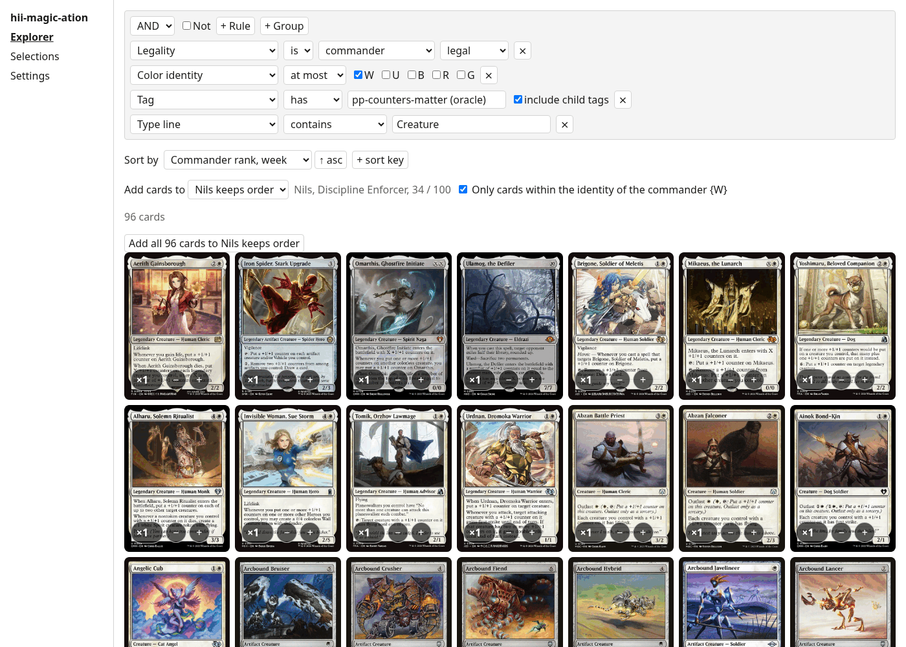
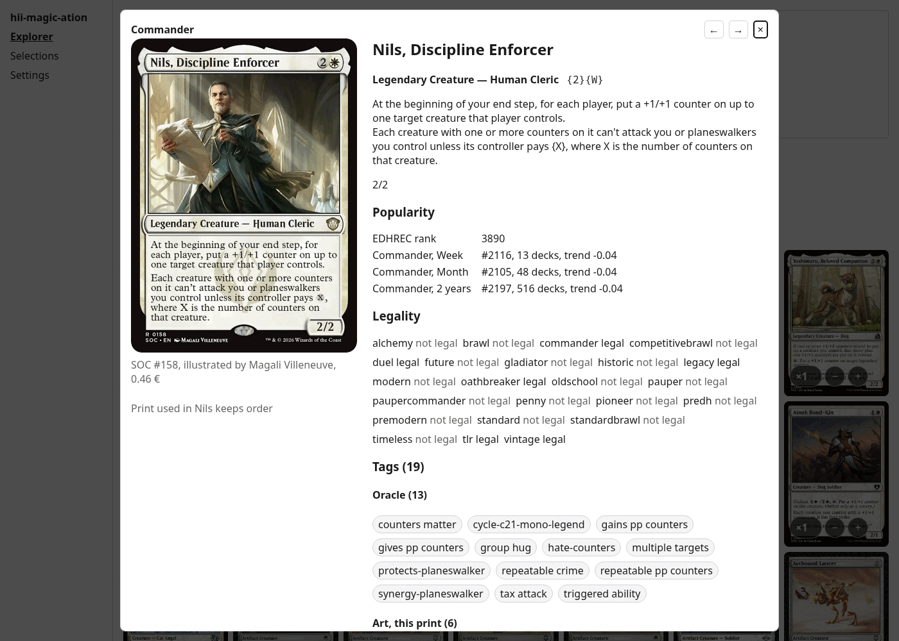
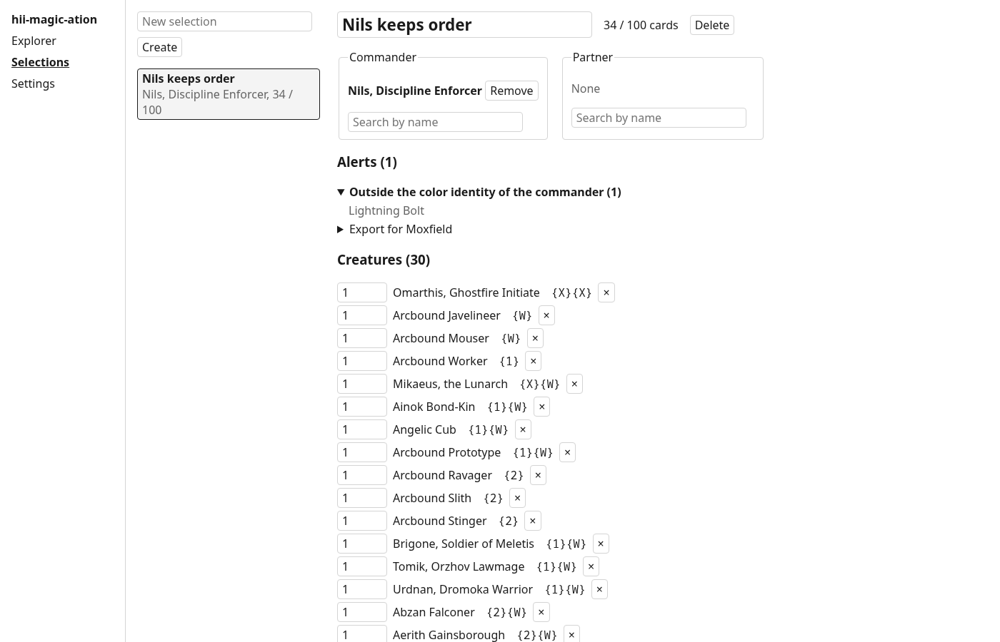

# hii-magic-ation

A local web app to search every Commander-legal Magic: The Gathering card, collect cards around a theme, and export the result to Moxfield.



## Why it exists

Building a themed Commander deck usually means jumping between tools. Scryfall has every card and tag, but a complex search turns into a long string of text syntax, and it does not know what people play. EDHREC knows what people play, but not your theme.

hii-magic-ation puts the Scryfall catalog and EDHREC commander rankings into a local DuckDB database on your machine. You build searches visually, collect cards into a draft selection while you browse, pick the exact print you want, and copy the finished list into Moxfield.

The screenshot above is a real search for a Nils, Discipline Enforcer deck. It asks for creatures legal in Commander, within white, with the `pp-counters-matter` tag (+1/+1 counters) or one of its child tags, sorted by this week's commander rank. That gives 96 cards. Another search, `Can be commander` is true sorted by `Commander rank, week`, lists the commanders people build most right now.

## Features

### Search and sort (`Explorer`)

- **Visual filter tree.** Combine `AND`, `OR`, and `NOT` groups up to any depth.
- **Card, print, and tag rules.** Filter on format legality, name, oracle text, type line, flavor text, rulings, colors, color identity, mana value, power, toughness, loyalty, keywords, Scryfall oracle and art tags (with an option to include child tags), commander eligibility, EUR price, artist, set code, and release year.
- **Regular expressions.** Text fields (name, oracle text, type line, flavor text, rulings) accept case-insensitive RE2 regular expressions. `^` and `$` match each line and each face of a multi-face card. Invalid patterns fail before the query runs and show the RE2 error message.
- **EDHREC popularity.** Filter and sort by overall EDHREC card rank, or by commander rank, deck count, and trend score in each EDHREC window (week, month, year). Partner pairs are merged into each commander's stats.
- **Multi-key sort.** Sort by several fields at once, such as weekly commander rank ascending, then mana value ascending.
- **Infinite grid.** Results load 100 cards at a time with progressive Scryfall WebP images. Double-faced cards have a button on the tile to flip between front and back.
- **URL state.** The current filter, sort keys, open card, active selection, and deck mode live in the URL query string. Reloading or bookmarking the page keeps your exact state.

### Card detail window



- Click any card in the grid or in a selection to open the detail window. Use `ArrowLeft` and `ArrowRight` to step through the current list, and `Escape` or a click outside to close.
- Shows all faces, mana cost, type line, oracle text, stats, keywords, format legalities, rulings, and EDHREC ranks.
- Lists every English print, newest first. Clicking a print updates the card image, artist, EUR price, and filters the displayed art tags to the ones on that print's illustration.

### Selections and Moxfield export (`Selections`)



- **Draft decks.** Create, rename, and delete named selections. Cards are grouped by front-face type (`Creatures`, `Planeswalkers`, `Battles`, `Instants`, `Sorceries`, `Artifacts`, `Enchantments`, `Lands`) and counted toward 100.
- **Commander and partner.** Pick a commander and an optional partner by searching commander-eligible cards. When a selection is active in the `Explorer`, search results are restricted to the combined color identity of your commanders by default. Uncheck the identity box to browse off-color cards for a theme.
- **Add while browsing.** Add or remove cards directly from `Explorer` tiles or the detail window, or add every card matching the current filter in two clicks. Adding a card already in the selection increments its copy count.
- **Print choice.** Pick a specific print for any card, commander, or partner in the detail window and save it to the selection.
- **Non-blocking alerts.** The selection flags rule and theme issues without preventing edits: too many copies of a singleton card (respecting Basic lands, "any number" cards like Relentless Rats, and "up to N" cards like Seven Dwarves or Nazgûl), cards outside the commander's color identity, cards not legal in Commander, commanders that cannot be a commander, and commanders duplicated in the 99-card list.
- **Moxfield export.** Exports `QUANTITY NAME (SET) COLLECTOR_NUMBER` lines for clipboard copy or `.txt` download. Commander and partner lines are listed separately so you can set them in Moxfield's deck creation form without pasting them twice.

## Status

This project is in development and has no release yet. The data sync, search, detail window, selections, and Moxfield export described above work. Planned next: grouping a selection by category, mana value or color, a table view, custom tags, AI-assisted tagging, similar-card search, and a Docker image. `docs/progress.md` tracks each milestone.

It is tested on Linux x86_64 only.

## Requirements

- Rust 1.85 or newer (edition 2024)
- Node.js 22.12 or newer, with npm
- An internet connection for the first build and the first sync

The `duckdb` crate downloads the official prebuilt `libduckdb` (v2.0.0) into `target/` during the first build. Nothing compiles DuckDB from source.

## Quick start

```sh
git clone https://github.com/ninouGx/hii-magic-ation.git
cd hii-magic-ation

# Build the frontend first so the Rust binary can embed web/dist
(cd web && npm ci && npm run build)

# Download Scryfall and EDHREC data and build the catalog
cargo run --release -p hii-magic-ation -- sync

# Start the server on http://127.0.0.1:7878
cargo run --release -p hii-magic-ation
```

The first sync downloads about 130 MB from Scryfall and about 170 pages from EDHREC at one request per second. Expect around 5 minutes. Later syncs only download files that changed upstream (EDHREC pages are cached for 24 hours).

You can also start the server first, open `http://127.0.0.1:7878`, go to `Settings`, and click **Sync all**.

## Configuration

Settings load from defaults, then the TOML config file, then `HMA_*` environment variables.

| Key | Variable | Default |
|---|---|---|
| `data_dir` | `HMA_DATA_DIR` | `$XDG_DATA_HOME/hii-magic-ation` (`~/.local/share/hii-magic-ation`) |
| `bind` | `HMA_BIND` | `127.0.0.1:7878` |

The default config file path is `$XDG_CONFIG_HOME/hii-magic-ation/config.toml` (`~/.config/hii-magic-ation/config.toml`). Pass `--config <path>` to use another file:

```toml
data_dir = "/srv/mtg"
bind = "127.0.0.1:8080"
```

`RUST_LOG` controls log output and defaults to `info`.

### Data directory

`data_dir` contains:

- `user.duckdb`: your selections. Back up this file, nothing else rebuilds it.
- `catalog.duckdb`: the read-only card catalog, rebuilt on sync.
- `raw/`: downloaded Scryfall `.jsonl.gz` bulk files and EDHREC JSON pages.

## Commands

With `cargo run`, pass arguments after `--`:

| Command | Effect |
|---|---|
| `cargo run --release -p hii-magic-ation` | Serve the API and web UI (same as `serve`) |
| `cargo run --release -p hii-magic-ation -- serve` | Serve the API and web UI |
| `cargo run --release -p hii-magic-ation -- sync` | Download changed sources, rebuild the catalog, and reload the running server |
| `cargo run --release -p hii-magic-ation -- sync --only scryfall` | Sync one source (`scryfall` or `edhrec`) |
| `cargo run --release -p hii-magic-ation -- sync --rebuild` | Rebuild the catalog even if no source file changed |
| `cargo run --release -p hii-magic-ation -- verify commanders` | Check local commander eligibility against Scryfall `is:commander legal:commander` |

The compiled binary is at `target/release/hii-magic-ation` (see Troubleshooting if you run it directly without `cargo run`).

## Troubleshooting

- **`front not built, run npm run build in web/`** when opening the app. Build the frontend with `(cd web && npm run build)` and recompile the Rust binary so `rust-embed` picks up `web/dist`.
- **`no catalog yet, run a sync first`** when searching. Run `cargo run --release -p hii-magic-ation -- sync` or trigger a sync from the `Settings` screen.
- **`libduckdb.so: cannot open shared object file`** when running `target/release/hii-magic-ation` directly. `cargo run` sets `LD_LIBRARY_PATH` automatically. To run the binary directly, point `LD_LIBRARY_PATH` at the `target/release/build/libduckdb-sys-.../out` directory that contains `libduckdb.so`.
- **Database lock error on startup.** Only one server process can open `user.duckdb` in a given `data_dir` at a time. Running `sync` while the server is up is safe because `sync` writes `catalog.duckdb.new` and asks the server to hot-swap it.
- **A tag rule does not filter.** In the `Tag` filter input, pick an entry from the autocomplete dropdown (formatted as `slug (oracle)` or `slug (art)`) so the rule resolves its tag ID.
- **A regular expression fails.** DuckDB uses RE2, which does not support lookahead (`(?=...)`, `(?!...)`) or backreferences.

## Development

```sh
./scripts/check.sh          # front lint, vitest, vite build, cargo fmt, clippy, cargo test
cd web && npm run dev       # Vite dev server with /api proxied to 127.0.0.1:7878
```

Workspace layout:

- `crates/core` (`hma-core`): domain types, DuckDB connection and migrations, filter compiler, search, selections, Moxfield export.
- `crates/ingest` (`hma-ingest`): Scryfall and EDHREC clients, catalog build SQL, commander verification.
- `crates/server` (`hii-magic-ation`): axum HTTP API, CLI, embedded frontend.
- `web/`: React 19, TypeScript, Vite, TanStack Query, `react-querybuilder`.

`docs/decisions.md` records every departure from the initial specification and the measurements behind it. Automated tests run against recorded fixtures in `crates/*/tests/fixtures/` and never call external services.

## Data sources

- [Scryfall](https://scryfall.com) bulk data: oracle cards, default prints, rulings, oracle tags, and art tags. Card images are loaded directly from `cards.scryfall.io` unmodified.
- [EDHREC](https://edhrec.com): commander rankings, fetched at 1 request per second and cached for 24 hours.

This project is not affiliated with or endorsed by Scryfall or EDHREC. The test fixtures under `crates/*/tests/fixtures/` are small samples of their data kept for offline testing.

hii-magic-ation is unofficial Fan Content permitted under the [Fan Content Policy](https://company.wizards.com/fancontentpolicy). Not approved or endorsed by Wizards. Portions of the materials used are property of Wizards of the Coast. ©Wizards of the Coast LLC.

## License

The code is licensed under the MIT License, see [LICENSE](LICENSE). Card data and images remain the property of their respective owners.
